# Lab3Web

## Praktikum 3: CSS Dasar

## Identitas
- **Nama** : Muhammad Agusti Abi Rizqi
- **NIM** : 312510042
- **Kelas** : I253A 
- **Prodi / Semester** : Teknik Informatika / 3

## Tujuan
1. Mahasiswa mampu memahami konsep dasar CSS
2. Mahasiswa mampu memahami aturan penulisan pada CSS
3. Mahasiswa mampu membuat pengaturan CSS pada HTML

## Langkah-langkah Praktikum
1. Membuat Repository baru yang bernama Lab3Web

    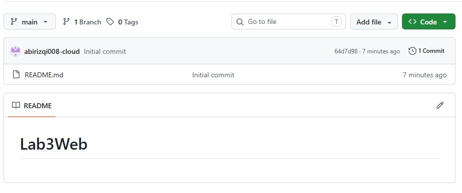

2. Membuat dokumen HTML.

    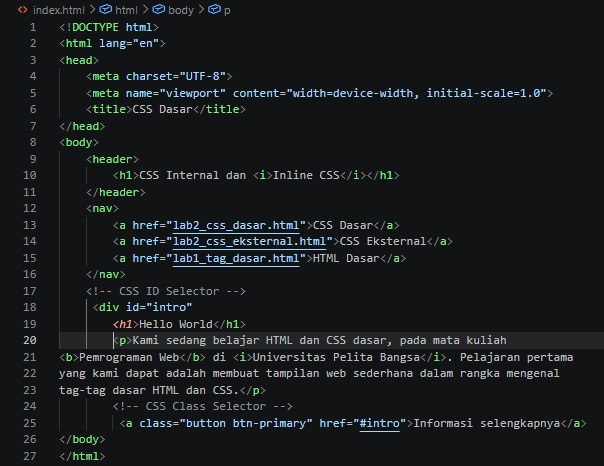

    ## Berikut adalah penjelasan bagian per bagian dari kode dokumen HTML di atas:
    - ** `<!DOCTYPE html>` & `<html lang="en">`**: Menunjukkan bahwa dokumen ini menggunakan standar HTML5 dengan bahasa utama bahasa Inggris.
    - ** `<head>`**: Bagian kepala dokumen yang berisi informasi pengaturan browser (seperti pengenal karakter UTF-8 dan ukuran layar/viewport) serta judul halaman web (`<title>`).
    - ** `<body>`**: Badan dokumen tempat seluruh konten yang akan tampil di layar browser diletakkan.
    - ** `<header>`**: Bagian kepala halaman yang membungkus judul utama web, yaitu _"CSS Internal dan Inline CSS"_. Di dalamnya terdapat tag `<i>` untuk membuat teks miring.
    - ** `<nav>`**: Elemen navigasi yang berisi kumpulan tautan (`<a>`) untuk berpindah antar halaman praktikum (seperti halaman CSS Dasar, CSS Eksternal, dan HTML Dasar).
    - ** `<div id="intro">`**: Sebuah wadah (*container*) yang dikhususkan menggunakan atribut `id` dengan nama `intro` untuk mengelompokkan bagian pengantar atau sambutan.
    - ** `<p>` (Paragraf)**: Tag untuk menuliskan teks paragraf penjelasan mengenai materi kuliah.
    - ** Tag `<b>` dan `<i>`**: Digunakan untuk menebalkan teks (`<b>Pemrograman Web</b>`) dan memiringkan teks (`<i>Universitas Pelita Bangsa</i>`).
    - ** `<a class="button btn-primary" ...>`**: Elemen tautan yang diberi kelas khusus (`button btn-primary`) agar nantinya dapat diatur tampilannya menjadi bentuk tombol melalui CSS.

## Hasil
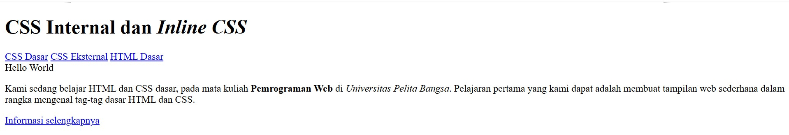

3. Mendeklarasi CSS Internal

    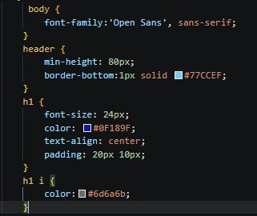

    ## Berikut adalah penjelasan baris per baris untuk setiap aturan style CSS yang digunakan:
    - **`body { font-family: 'Open Sans', sans-serif; }`**: Mengatur jenis huruf (*font*) utama di seluruh halaman web menggunakan jenis `'Open Sans'`, dan jika tidak tersedia akan menggunakan jenis huruf standar *sans-serif*.
    - **`header { min-height: 80px; border-bottom: 1px solid #77CCEF; }`**: Mengatur tinggi minimum area kepala halaman (*header*) sebesar 80 piksel dan menambahkan garis bawah tipis berwarna biru muda (`#77CCEF`).
    - **`h1 { font-size: 24px; color: #0F189F; text-align: center; padding: 20px 10px; }`**: Mengatur ukuran teks judul utama (`<h1>`) menjadi 24 piksel, memberikan warna biru tua, membuat posisi teks berada di tengah (*center*), serta memberikan jarak ruang di dalam (*padding*) atas-bawah 20px dan kiri-kanan 10px.
    - **`h1 i { color: #6d6a6b; }`**: Memberikan warna khusus abu-abu tua untuk elemen teks miring (`<i>`) yang berada di dalam tag judul utama (`<h1>`).
    
## Hasil
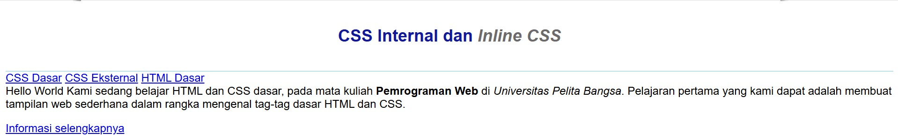

4. Membuat Inline CSS

    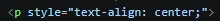

    ## Berikut adalah penjelasan Atribut Style Paragraf (Warna Khusus):
    - **`<p style="...">`**: Menambahkan atribut *inline CSS* langsung ke dalam tag paragraf untuk mengatur gaya tampilan khusus pada elemen tersebut.
    - **`text-align: center;`**: Properti CSS yang berfungsi untuk membuat posisi teks berada di tengah halaman (*center alignment*).
    - **`color: #ccd8e4;`**: Properti CSS untuk menentukan warna teks menggunakan kode heksadesimal, di mana `#ccd8e4` menghasilkan warna abu-abu kebiruan yang lembut (*light steel/grayish blue*).

## Hasil
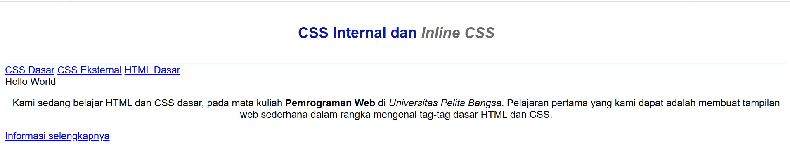

5. Membuat CSS Eksternal

    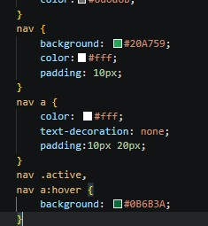
    ## Penjelasan Kode CSS (Navigasi):
    - **`nav { background: #20A759; color: #fff; padding: 10px; }`**: Mengatur wadah menu navigasi (`<nav>`) dengan latar belakang warna hijau cerah (`#20A759`), warna dasar teks putih (`#fff`), serta memberikan jarak ruang di dalam elemen sebesar 10 piksel agar terlihat rapi.
    - **`nav a { color: #fff; text-decoration: none; padding: 10px 20px; }`**: Mengatur tampilan setiap tautan (*link*) di dalam menu navigasi:
    - `color: #fff;`: Membuat warna teks tautan menjadi putih.
    - `text-decoration: none;`: Menghilangkan garis bawah bawaan pada tautan.
    - `padding: 10px 20px;`: Memberikan jarak ruang di sekeliling teks agar area klik menu menjadi lebih luas dan nyaman digunakan.
    - **`nav .active, nav a:hover { background: #0B6B3A; }`**: Mengatur efek interaktif pada menu:
    - Mengubah warna latar belakang tautan menjadi hijau yang lebih gelap (`#0B6B3A`) secara otomatis saat kursor mouse diarahkan ke menu tersebut (`:hover`) atau ketika menu sedang berada pada halaman aktif (`.active`).

## Hasil
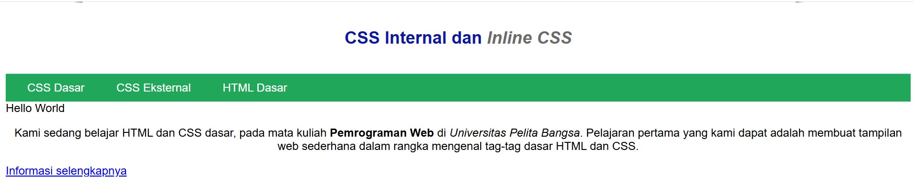

6. Membuat tambahkan tag `<link>` untuk merujuk file css yang sudah dibuat pada bagian `<head>`

    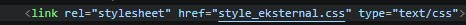
    ## Penjelasan Tag Link untuk CSS Eksternal
    - **`<link>`**: Tag HTML yang digunakan untuk menghubungkan dokumen HTML saat ini dengan sumber daya eksternal (seperti file *stylesheet* CSS). Tag ini diletakkan di dalam bagian `<head>`.
    - **`rel="stylesheet"`**: Atribut *relationship* yang mendefinisikan bahwa file yang dituju berfungsi sebagai lembar gaya (*stylesheet*) untuk mengatur tampilan halaman web.
    - **`href="style_eksternal.css"`**: Atribut *hypertext reference* yang berisi lokasi atau nama file CSS eksternal yang ingin dihubungkan (dalam hal ini bernama `style_eksternal.css` dan berada pada satu folder yang sama).
    - **`type="text/css"`**: Atribut opsional yang memberikan informasi kepada *browser* bahwa jenis konten dari file yang dihubungkan adalah teks dengan format CSS.

## Hasil
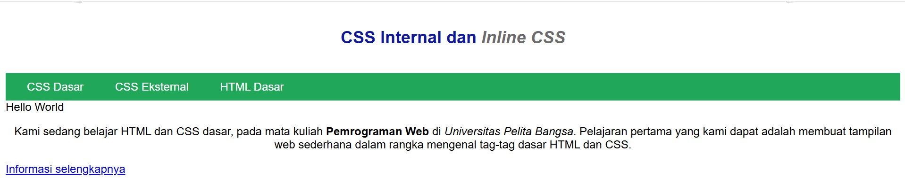

7. Menambahkan CSS Selector
    Selanjutnya, kita akan menambahkan CSS Selector menggunakan ID Selector dan Class Selector. Pada file `style_eksternal.css`, tambahkan kode berikut:

    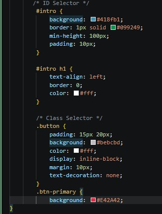

    ## Berikut adalah penjelasan fungsi dari setiap baris kode CSS Selector yang ditambahkan ke dalam file `style_eksternal.css`:
    ## 1. ID Selector (`#intro`)
    - **`#intro { background: #418fb1; border: 1px solid #099249; min-height: 100px; padding: 10px; }`**: Mengatur tampilan wadah elemen yang memiliki ID `intro`:
    - `background: #418fb1;`: Memberikan warna latar belakang biru muda.
    - `border: 1px solid #099249;`: Menambahkan garis tepi tipis berwarna hijau.
    - `min-height: 100px;`: Menentukan batas tinggi minimum elemen sebesar 100 piksel.
    - `padding: 10px;`: Memberikan jarak ruang di dalam elemen sebesar 10 piksel.

    - **`#intro h1 { text-align: left; border: 0; color: #fff; }`**: Mengatur khusus elemen judul (`<h1>`) yang berada di dalam wadah `#intro`:
    - `text-align: left;`: Membuat posisi teks menjadi rata kiri.
    - `border: 0;`: Menghilangkan garis tepi pada elemen judul.
    - `color: #fff;`: Mengubah warna teks judul menjadi putih.

    ## 2. Class Selector (`.button` dan `.btn-primary`)
    - **`.button { padding: 15px 20px; background: #bebcbd; color: #fff; display: inline-block; margin: 10px; text-decoration: none; }`**: Membuat gaya dasar untuk tombol (*button*):
    - `padding: 15px 20px;`: Mengatur ukuran ruang di dalam tombol.
    - `background: #bebcbd;`: Memberikan warna latar belakang abu-abu standar.
    - `color: #fff;`: Mengatur warna teks tombol menjadi putih.
    - `display: inline-block;`: Membuat elemen tautan ber行为 seperti kotak/blok tombol.
    - `margin: 10px;`: Memberikan jarak luar di sekeliling tombol.
    - `text-decoration: none;`: Menghilangkan garis bawah pada teks tautan.

    - **`.btn-primary { background: #E42A42; }`**: Memberikan variasi atau modifikasi warna latar belakang khusus untuk tombol utama (*primary*) menjadi warna merah terang (`#E42A42`).

## Hasil
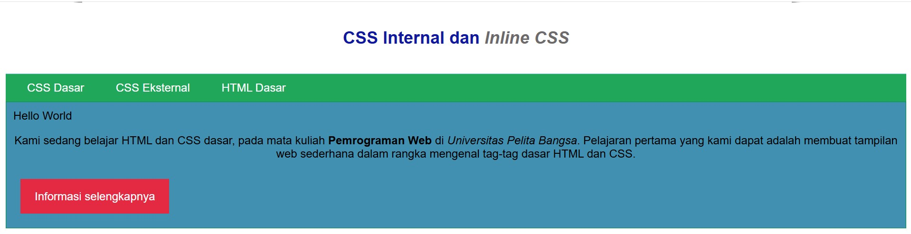

## Pertanyaan dan Tugas
1. ## Lakukan eksperimen dengan mengubah dan menambah properti dan nilai pada kode CSS dengan mengacu pada CSS Cheat Sheet yang diberikan pada file terpisah dari modul ini.

    - Eksperimen pada ID Selector (#intro)

        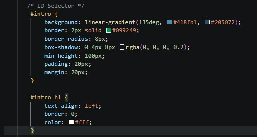

    ## Hasil
    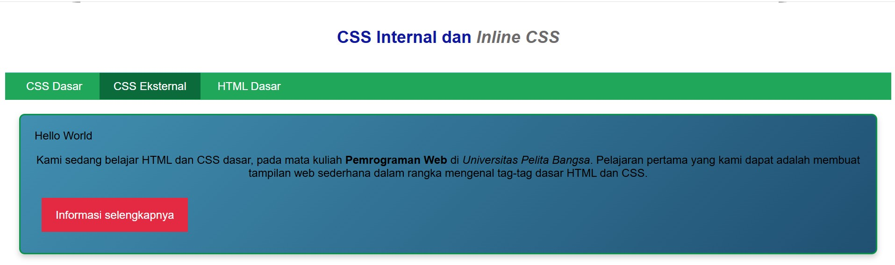

2. ## Apa perbedaan pendeklarasian CSS elemen h1 {...} dengan #intro h1 {...}? berikan penjelasannya!

    Jawab:

    ## Perbedaan Penulisan `h1` dan `#intro h1` pada CSS
    Berikut adalah perbedaan mendasar antara pendeklarasian elemen `h1 {...}` secara umum dengan `#intro h1 {...}` (Descendant Selector):
    - **`h1 { ... }` (Global / Elemen Selector):**
    - Berfungsi untuk menargetkan **seluruh** elemen judul `<h1>` yang ada di dalam dokumen HTML, di mana pun elemen tersebut diletakkan.
    - Setiap perubahan properti di dalam blok ini (seperti ukuran font, warna, atau perataan teks) akan diterapkan secara seragam ke semua tag `<h1>` pada halaman web.

    - **`#intro h1 { ... }` (Descendant Selector / Spesifik):**
    - Berfungsi untuk menargetkan elemen judul `<h1>` yang **hanya berada di dalam** wadah atau elemen pembungkus yang memiliki ID `intro` (`id="intro"`).
    - Bersifat lebih spesifik dan memiliki tingkat prioritas (*specificity*) yang lebih tinggi. Properti di dalam blok ini hanya akan mengubah tampilan `<h1>` di dalam area `#intro` saja, tanpa memengaruhi elemen `<h1>` lain di luar bagian tersebut.

    ### Contoh Kasus Penggunaan:
    Jika Anda ingin membuat judul utama halaman berwarna biru di bagian *header*, Anda cukup menggunakan `h1 { color: #0F189F; }`. Namun, jika khusus untuk judul di dalam kotak perkenalan `#intro` Anda ingin mengubah warnanya menjadi putih (`color: #fff;`) dan posisinya rata kiri (`text-align: left;`), maka pendeklarasian `#intro h1` digunakan untuk menimpa atau mengkhususkan gaya tersebut.

3. ## Apabila ada deklarasi CSS secara internal, lalu ditambahkan CSS eksternal dan inline CSS pada elemen yang sama. Deklarasi manakah yang akan ditampilkan pada browser? Berikan penjelasan dan contohnya!

    Jawab:

    ## Prioritas Penerapan CSS (Inline, Internal, dan Eksternal)
    Apabila sebuah elemen HTML diberikan gaya (*style*) melalui **Inline CSS**, **Internal CSS**, dan **Eksternal CSS** secara bersamaan, browser akan menentukan gaya mana yang akan ditampilkan berdasarkan tingkat prioritas (*Specificity* dan *Cascade*).
    
    ## Urutan Prioritas CSS (Dari yang Paling Kuat ke Lemah)
    1. **Inline CSS (Prioritas Tertinggi)**
        - Ditulis secara langsung di dalam elemen HTML menggunakan atribut `style="..."`.
        - Gaya ini akan selalu diutamakan dan menimpa gaya apa pun yang ada di dalam Internal maupun Eksternal CSS.

    2. **Internal CSS & Eksternal CSS (Tergantung Urutan Pemuatan)**
        - Jika konflik terjadi antara Internal CSS (dalam tag `<style>`) dan Eksternal CSS (lewat tag `<link>`), maka aturan yang **dibaca atau dimuat paling akhir** oleh browser akan mendominasi (*Cascading order*).
    
    ---
    
    ## Contoh Kasus
    
    Misalkan kita memiliki elemen judul `<h1>` dengan kondisi kode sebagai berikut:
    - **Di CSS Eksternal/Internal**: Diberikan warna biru (`color: blue;`).
    - **Di Inline CSS**: Ditulis langsung pada elemen `<h1 style="color: red;">Halo Dunia</h1>`.
    
    **Hasil di Browser:**
    Teks judul akan tampil dengan warna **merah (`red`)**. Hal ini karena **Inline CSS** memiliki tingkat prioritas tertinggi dan mengabaikan aturan warna biru yang didefinisikan pada CSS Internal maupun Eksternal.

4. ## Apabila sebuah elemen HTML memiliki atribut **ID** dan **Class** secara bersamaan (contoh: `<p id="paragraf-1" class="text-paragraf">`), dan kedua selector tersebut sama-sama mendeklarasikan properti CSS yang sama (misalnya warna teks), maka browser akan menampilkan **deklarasi dari ID Selector**.

    ## Penjelasan (Tingkat Spesifisitas / *Specificity*)
    Dalam aturan CSS, setiap jenis selector memiliki bobot atau nilai spesifisitas (*specificity*) yang berbeda-beda:
    1. **ID Selector (`#...`)**: Memiliki bobot spesifisitas yang **lebih tinggi** (dianggap sebagai selektor yang sangat spesifik).
    2. **Class Selector (`....`)**: Memiliki bobot spesifisitas yang **lebih rendah** dibanding ID Selector.
    
    Karena ID Selector memiliki bobot yang lebih tinggi, aturan apa pun di dalam ID Selector akan selalu mengalahkan (*override*) aturan yang ada di dalam Class Selector, terlepas dari urutan penulisan kodenya di dalam file CSS.
    
    ---
    
    ### Contoh Kasus
    
    Misalkan kita menuliskan kode CSS berikut untuk elemen `<p id="paragraf-1" class="text-paragraf">`:
    
    ```css
    /* Class Selector */
    .text-paragraf {
    color: blue;
    }

    /* ID Selector */
    #paragraf-1 {
    color: red;
    }